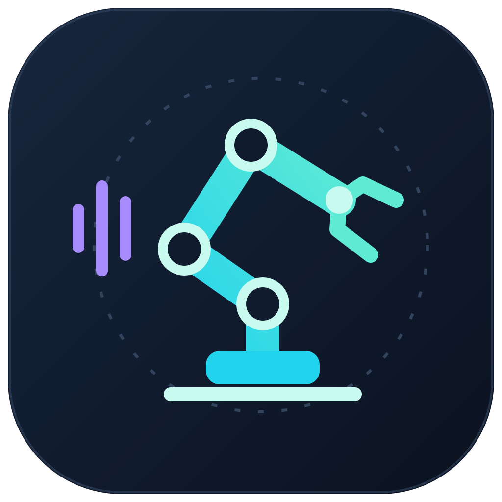
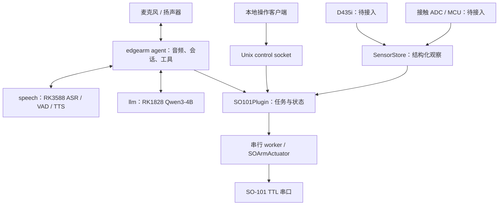

<p align="center">
  
</p>

<h1 align="center">EdgeArm</h1>

<p align="center">
  <a href="LICENSE"></a>
  
  
  <br>
  
  
  
  
</p>

<p align="center">
  Qwen3-ASR · Qwen3-4B · Matcha/Vocos — <strong>本地推理 · 按键说话 · SO-101 任务接口</strong>
</p>

<!-- TODO: 完成板端语音闭环验收后，录制约 15 秒的真实演示 GIF：
     1. 展示服务健康状态和调试页面。
     2. 按键说话，展示中文识别、LLM 回复和语音播放。
     3. 展示 robot_query 状态查询；机械臂动作在完成实机验收后录制。
     演示和延迟数据以本机实录为准。 -->

EdgeArm 面向 RK3588 主板、PCIe RK1828 加速卡和 SO-101 机械臂，将语音识别、对话、语音合成与机器人任务接口放在同一台设备上。项目基于 [OpenVoiceStream](https://github.com/Seeed-Solution/openvoicestream)，复用其语音服务、会话、音频和工具执行框架，Rockchip 语音推理由固定版本的 [rkvoice-stream](https://github.com/suharvest/rkvoice-stream) 提供。

默认中文链路：**Silero VAD → Qwen3-ASR（RK3588）→ Qwen3-4B（RK1828）→ Matcha/Vocos TTS**。应用入口为 `edgearm`，交互采用按键说话。模型和运行依赖准备完成后，对话推理在本地运行；首次下载模型、镜像和依赖需要网络。

当前已完成软件集成与回归检查。真实录放音、完整语音链路和机械臂动作仍需板端验收；D435i、接触传感器及抓放规划/结果验证仍待接入。默认配置关闭机械臂运动。

## 目录

- [功能](#功能)
- [目标硬件与运行环境](#目标硬件与运行环境)
- [快速开始](#快速开始)
- [模型准备](#模型准备)
- [配置](#配置)
- [接口](#接口)
- [架构](#架构)
- [测试与验证](#测试与验证)
- [项目结构](#项目结构)
- [参与开发](#参与开发)
- [来源与许可](#来源与许可)

## 功能

### 语音与对话

- **本地 ASR**：Qwen3-ASR 使用 RKNN encoder 和 RKLLM decoder，默认运行在 RK3588 上。
- **本地 LLM**：Qwen3-4B 通过 RKNN3 在 PCIe RK1828 上运行，提供 OpenAI-compatible HTTP 接口。
- **流式 TTS**：Matcha 使用 ONNX Runtime 声学模型，Vocos 使用 RKNN 声码器，通过语音服务输出音频。
- **交互与会话**：复用 OVS 的 WebSocket 会话、音频输入输出、会话预算和工具调用；默认中文、单会话、按键说话。
- **本地调试**：提供调试页面、服务健康检查和日志，应用入口统一为 `edgearm run`。

### 机械臂任务接口

| 接口 | 用途 | 当前实现范围 |
|---|---|---|
| `robot_query` | 查询机器人健康、物体/放置区 ID 和请求令牌 | 状态与结构化观察接口 |
| `robot_grasp_place` | 请求将物体抓放到指定区域 | 已有任务契约；实际规划与结果验证后端待接入 |
| `robot_cancel` | 取消任务并请求受控停止 | 软件取消与停止流程，实机效果待验证 |

SO-101 串口调用由一个串行 worker 持有；查询读取缓存。运动使能使用独立的本地操作接口，LLM 工具中没有使能操作。缺少抓放后端或新鲜观察时，任务返回拒绝。

感知、接触和抓放扩展的实现边界见 [项目范围](docs/scope.md) 与 [运行手册](docs/runbook.md)。

## 目标硬件与运行环境

| 组件 | 选定方案 | 职责 |
|---|---|---|
| 主板 | RK3588，16 GB 内存 / 128 GB 存储 | 语音、应用运行及后续视觉推理 |
| 加速卡 | PCIe RK1828 | RKNN3 本地 Qwen3-4B 推理 |
| 系统 | Ubuntu 22.04 ARM64、Python 3.10、兼容的 Rockchip BSP | 当前开发基线 |
| 音频 | 麦克风、扬声器及适配的全双工声卡 | 采集和播放，需录放音验收 |
| 机械臂 | SO-101，五关节及夹爪 | TTL 串口控制与反馈 |
| 深度相机 | D435i | 后续 RGB-D 感知与外参标定 |
| 接触传感器 | ADC/MCU 接口待选型 | 后续接触反馈 |

本项目的产品配置针对 RK3588 + RK1828。两者分别使用 RKNN2/RKLLM 和 RKNN3，需要各自配套的驱动、Runtime 与模型。第三方依赖中的其他平台和后端不属于 EdgeArm 的默认部署范围。

## 快速开始

### 1. 获取源码与准备开发环境

在目标 ARM64 板端执行，建议将仓库放在 `/userdata/EdgeArm`，与 Docker 数据目录配置保持一致：

```bash
cd /userdata
git clone --recurse-submodules https://github.com/Qin-tuo/EdgeArm.git
cd EdgeArm

scripts/setup-tools.sh
scripts/setup-dev.sh
source scripts/activate-env.sh
scripts/check.sh
```

已有仓库可从 `cd /userdata/EdgeArm` 开始。项目使用 **venv + pip**，依赖版本固定在 [deploy/python.lock.txt](deploy/python.lock.txt)。`setup-tools.sh` 准备项目内的 Docker CLI、daemon、Compose 和 Buildx；`setup-dev.sh` 安装应用开发依赖及 ARM64 默认后端所需的 Lite2 2.3.2。

当前 BSP 不具备完整容器支持，不更换内核时采用 [原生运行方案](docs/framework-audit.md)。ASR/TTS 基本推理已通过；RK1828 仅 EFFICIENT work / EFFICIENT prefill 在此前厂商服务 33 次、项目 worker 41 次及页面对话样本中通过传输检查。其他已测模式出现断链，两次重启后完全跳过 SMI 的对照也在首条 31-token 请求失败；根因未确定，冷断电首次上电尚未验证。长期稳定性与答案质量未通过，工具请求默认拒绝，录放音及机器人外设尚未完成验收。当前启动命令和测试边界见 [runbook](docs/runbook.md)。

以后每次打开终端，只需：

```bash
cd /userdata/EdgeArm
source scripts/activate-env.sh
```

激活脚本配置 `.venv`、本地控制 socket、Silero VAD 和 Docker CLI 路径，并清除 ROS 注入的 Python 搜索路径。板端直接运行 RKNN2 后端还需要官方 Lite2 2.3.2 包和匹配的 `librknnrt.so`；应用开发环境的安装不会替代 BSP/NPU Runtime 配置。

### 2. 检查板端条件并启动 Docker

确认 RK1828 设备、RKNN3 Runtime 和 transfer proxy 可用；具体排查步骤见 [运行手册](docs/runbook.md)。

```bash
systemctl status rk182x.service --no-pager
sudo scripts/start-docker.sh
```

`start-docker.sh` 保持前台运行。已有 Docker daemon 时，先确认其数据目录位于 `/userdata`，再使用它。在另一个终端执行：

```bash
cd /userdata/EdgeArm
source scripts/activate-env.sh
sudo .venv/bin/python scripts/doctor.py --json
```

`doctor.py` 检查主机条件；实际 NPU 推理与录放音需要另行验证。

### 3. 构建并启动完整应用

默认 Compose 启动 `speech`、`llm` 和 `agent` 三个服务。基础镜像固定 digest，构建时叠加本项目源码。

**使用本机已有 Qwen3-4B 模型时，先按 [模型说明](docs/model-storage.md) 配置覆盖文件，并为下面的 Compose 命令加入 `-f .local/deploy/models.local.yaml`。** 新克隆的仓库不包含这个本机文件。

```bash
sudo scripts/compose.sh build
sudo scripts/compose.sh up -d
sudo scripts/compose.sh ps
sudo scripts/compose.sh logs --tail=100
```

首次启动会按所选清单获取、校验所需模型。启动时间取决于网络、模型准备和加载情况；`agent` 等待语音与 LLM 服务健康后启动。

```bash
curl -fsS http://127.0.0.1:8621/health
curl -fsS http://127.0.0.1:1828/health
```

板端调试页面为 **http://127.0.0.1:18000**。通过 SSH 操作时，在 PC 上转发端口，再打开本机同一地址：

```bash
ssh -L 18000:127.0.0.1:18000 ubuntu@BOARD_IP  # 将 BOARD_IP 替换为板子 IP
```

### 本地调试 agent

语音和 LLM 服务就绪后，可在项目环境中运行 agent；调试前先停止 Compose 中的 agent，避免同时占用音频设备和控制 socket：

```bash
sudo scripts/compose.sh stop agent
edgearm run edgearm --config deploy/agent-config.yaml
```

完整应用的默认部署仍使用上述 Compose。本地命令只启动 agent。

## 模型准备

模型不随 Git 仓库分发。主机默认数据根目录为 `.local/data/`，Compose 将其挂载到对应服务：

| 用途 | 主机目录 | 容器目录 | 完整性清单 |
|---|---|---|---|
| Qwen3-ASR | `.local/data/asr/` | `/opt/asr/models/` | [RK 模型清单](deploy/artifacts/rk_manifest.json) |
| Matcha/Vocos | `.local/data/tts/` | `/opt/tts/models/` | RK 清单与 [Matcha 清单](server/core/matcha_artifacts.json) |
| Qwen3-4B | `.local/data/llm/` | `/opt/llm/models/` | [默认 RK1828 清单](services/rk1828-llm/artifacts.json)或配套的本机清单 |
| Silero VAD | `server/core/assets/silero_vad.onnx` | `/opt/voice/assets/silero_vad.onnx` | [版本锁](deploy/baseline.lock.json) |

ASR 需要 tokenizer、embedding、mel filters、encoder 和 decoder 等配套资源；Matcha 还需要词典、音素表和语言资源。下载与加载按文件大小和 SHA256 校验。

已有 RK_LLM V1.1.0 导出的 Qwen3-4B 可通过本机模型清单和 Compose 覆盖配置接入，详见 [本机模型位置与启动配置](docs/model-storage.md)。模型图、权重、tokenizer 和 Runtime 必须按配套发布版本核对。

## 配置

| 文件 | 用途 |
|---|---|
| [deploy/agent-config.yaml](deploy/agent-config.yaml) | 语言、LLM、音频、交互方式和机器人配置 |
| [deploy/cm3588.env](deploy/cm3588.env) | Compose 环境变量与模型下载地址 |
| [deploy/audio_profiles.yaml](deploy/audio_profiles.yaml) | 声卡匹配、通道选择和增益 |
| [configs/profiles/rk3588-default.json](configs/profiles/rk3588-default.json) | Qwen3-ASR + Matcha/Vocos 语音后端参数 |
| [deploy/compose.yaml](deploy/compose.yaml) | 服务、设备、模型挂载、内存与健康检查 |
| [deploy/baseline.lock.json](deploy/baseline.lock.json) | 上游源码、子模块、镜像和模型清单版本 |

默认参数为中文、单会话、2048 token LLM 上下文、按键说话；打断关闭，`metadata.robot.enabled` 为 `false`。

声卡配置可放在忽略 Git 的本机环境文件中：

```bash
cp deploy/cm3588.env deploy/cm3588.local.env
# 编辑 EDGEARM_AUDIO_INPUT / EDGEARM_AUDIO_OUTPUT 等配置
sudo env EDGEARM_ENV_FILE=/userdata/EdgeArm/deploy/cm3588.local.env \
  scripts/compose.sh up -d
```

连接 SO-101 需要真实串口、六电机标定、限位及标定文件 SHA256。`enabled: true` 允许连接与读取反馈，运动仍需通过本地接口人工使能；接入步骤见 [运行手册](docs/runbook.md)。

## 接口

### 语音与 LLM 服务

| 服务 | 方法 | 地址/路径 | 用途 |
|---|---|---|---|
| speech · `127.0.0.1:8621` | GET | `/health`、`/readyz` | 健康与就绪检查 |
| speech | POST | `/asr` | 音频转录 |
| speech | WS | `/asr/stream` | 流式 ASR |
| speech | POST | `/tts`、`/tts/stream` | WAV 合成与 PCM 流式合成 |
| speech | WS | `/v2v/stream` | agent 使用的持续语音会话 |
| speech | GET | `/v1/capabilities` | 服务能力信息 |
| llm · `127.0.0.1:1828` | GET | `/health`、`/v1/models` | 健康与模型信息 |
| llm | POST | `/v1/chat/completions` | OpenAI-compatible 对话 |

协议细节见 [V2V stream](docs/api/v2v-stream.md) 和 [Realtime v2](docs/api/realtime-v2.md)。服务接口的能力以当前选定后端为准。

### 本地机器人操作

操作客户端通过 `.local/run/edgearm/control.sock` 通信，应用运行时可查询状态和请求停止：

```bash
python scripts/control.py status
python scripts/control.py stop
```

人工使能使用 `python scripts/control.py enable`，按运行手册完成接入后执行。客户端需要与服务相应的 socket 访问权限。

## 架构



agent 持有音频设备和工具调用；speech 持有语音模型；LLM 服务通过主机 RKNN3 proxy 驱动 RK1828。传感器适配器通过 `SensorStore` 发布带时间和标定版本的观察，抓放后端负责规划与结果验证。

资源所有权、执行器状态和扩展契约见 [当前软件架构](ARCHITECTURE.md)，系统设计见 [SO-101 Rockchip 架构书](01-so101-rockchip-system-architecture.md)。

## 测试与验证

```bash
source scripts/activate-env.sh
scripts/check.sh
```

检查覆盖依赖、Docker/Compose 配置、产品导入、版本锁、文档链接，以及 agent、server 和机械臂契约回归。日志与 JUnit 报告保存在 `.local/reports/`。

模型文件和真实服务推理可分别检查：

```bash
python scripts/test-models.py --verify-only
# speech 和 llm 服务就绪后：
python scripts/test-models.py --services-only
```

推理检查覆盖 LLM 回复、有效 TTS 音频和 TTS→ASR 单句回读，报告与试听 WAV 保存在 `.local/reports/model-smoke/`。启动方式及通过条件见 [模型验证](docs/model-storage.md#验证模型)。

| 验证项 | 当前结果 |
|---|---|
| 软件回归（2026-10-12） | **1257 项通过、2 项跳过、0 失败** |
| Silero CPU VAD | 静音与仓库语音样本测试通过 |
| ASR/TTS 质量与延迟、完整 V2V 链路 | ASR/TTS 单句基本推理通过；完整质量、延迟及长期链路待验收 |
| 真实声卡、SO-101、D435i、接触反馈 | 待硬件接入与验收 |
| 语音/视觉 NPU 共存、峰值内存与热运行 | 待整机测量 |

软件测试使用 fake 验证机械臂与传感器契约。性能数据以本项目板端测量为准；验证记录和剩余验收项见 [软件验证](docs/validation.md) 与 [运行手册](docs/runbook.md)。

## 项目结构

```text
EdgeArm/
├── agent/ovs_agent/         # 共享语音 runtime 与 apps/edgearm
├── server/                 # 语音服务、会话及 RK 后端
├── services/rk1828-llm/     # 本地 LLM HTTP 服务
├── configs/profiles/       # rk3588-default 语音配置
├── deploy/                 # Compose、Dockerfile、配置与版本锁
├── scripts/                # 环境、检查、诊断及操作入口
├── docs/                   # 协议、部署、模型与验证文档
├── media/                  # README Logo；SVG 源文件与 PNG
├── third_party/rkvoice-stream/  # 固定提交的 Rockchip 依赖
├── tests/                  # 产品契约测试；各组件另有 tests/
└── .local/                 # 本机模型、工具、状态和报告，不提交 Git
```

Python 命名空间 `ovs_agent` 保留上游契约，项目命令与应用入口均为 `edgearm`。逐文件来源和裁剪记录见 [文件清单](docs/file-inventory.json)。

## 参与开发

在 [EdgeArm 仓库](https://github.com/Qin-tuo/EdgeArm) 提交问题或 PR。问题报告请附系统/内核、Runtime 与模型版本、复现步骤和相关日志；硬件问题还需提供设备连接与标定信息。

提交修改前运行 `scripts/check.sh`。感知、接触和抓放扩展沿用现有设备所有权与任务接口；新增模型或运行库时同步配套清单和验证记录。

## 来源与许可

- [OpenVoiceStream](https://github.com/Seeed-Solution/openvoicestream)：语音服务、agent、会话、音频和 SO 驱动的上游来源。
- [rkvoice-stream](https://github.com/suharvest/rkvoice-stream)：固定版本的 Rockchip 语音推理依赖。
- `voxedge`：文本与语音前端依赖，固定为 `0.0.15a1`。
- Rockchip RKNN2、RKLLM 与 RKNN3：对应平台的模型及运行工具链。

项目保留上游 [MIT License](LICENSE)。第三方依赖、模型、厂商 Runtime 与容器镜像按各自许可使用；具体来源与版本见 [NOTICE](NOTICE.md) 和 [版本锁](deploy/baseline.lock.json)。
