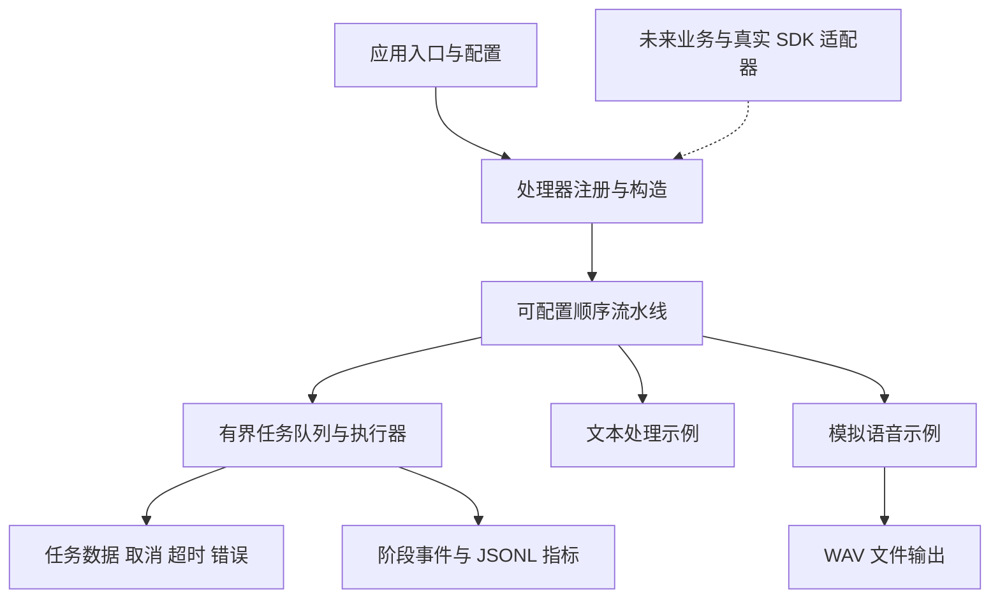

# 通用处理框架架构

当前目标是建立可更换业务流程、模型和设备的工程底座。仓库名称和早期任务书保留为背景，语音应用是框架的一个示例，不决定核心接口或后续项目范围。框架默认使用 C++17 标准库和线程库，Python 工具仅用于资产登记、指标汇总与测试。

## 模块与依赖

`rvs_core` 仅包含配置、类型化数据包、处理器接口、注册表、流水线、任务执行器和事件记录。核心不知道 ASR、LLM、TTS、麦克风、机器人动作或 RK3588/RK1828。`rvs_examples` 承载示例业务与 WAV 编码；它依赖核心，核心不依赖它。可以关闭示例，只构建核心库。

| 位置 | 职责 |
| --- | --- |
| `include/rvs/core/`、`src/core/` | 配置、Packet、错误、执行上下文与观察器 |
| `include/rvs/runtime/`、`src/runtime/` | Processor、Registry、Pipeline、Executor |
| `src/modules/` | 独立业务模块，通过工厂注册 |
| `src/audio/` | 示例需要的音频格式工具 |
| `apps/` | 命令行装配与运行产物管理 |
| `examples/` | 只依赖核心的自定义数值处理示例 |
| `configs/` | 通用、模拟语音与未来真实后端的配置 |
| `assets/manifests/` | 资产登记模板，不存放权重和数据集 |
| `tools/assets/`、`tools/benchmarks/` | 文件校验与分组指标汇总 |
| `tests/` | 调度、取消、超时、错误恢复和输出契约测试 |
| `third_party/` | 已核对的 GitHub 架构参考与版本记录 |

## 数据与处理器接口

`Packet` 是任务私有的数据包，字段值支持字符串、64 位整数、浮点数、布尔值、float 向量和字节向量。字段名及其含义由业务模块约定；字段缺失或类型错误返回 `invalid_input`。目前数据按值传递，适合先明确所有权；大规模图像或音频可在未来增加共享缓冲区类型。

每个 `Processor` 提供稳定的 `Descriptor` 和 `process(Packet&, Context)`。Descriptor 记录阶段名、后端、模型或资产标识，以及是否为模拟过程。实现可以封装库调用、计算逻辑或受控进程；SDK 类型不进入核心公共头文件。

`Registry` 使用显式工厂注册，不使用全局静态初始化，也不自动下载依赖。应用读取 `pipeline.stages`，按顺序构造处理器。工厂应校验配置且不产生外部副作用；耗时资源初始化需要后续适配器明确生命周期。重复阶段名、空流水线、未知处理器或未实现后端会直接报错。

第一版流水线按任务顺序执行阶段。一个任务的 Packet 不会传给下一个任务，因此上一个任务的部分输出不会自动进入新任务。会话历史、消息协议、动作权限与业务状态机由应用模块实现；当前核心不预设它们。

## 队列与取消语义

Executor 提供 `submit`、按任务 ID `cancel` 和 `shutdown`。Ticket 返回独立的共享 future，任务最终状态为 `completed`、`cancelled`、`timeout` 或 `failed`。

- 队列容量只计算等待任务；一名 worker 之外最多保留配置数量的待执行任务。队列满时抛出 `queue_full`，不静默丢弃任务。
- 超时从提交时刻开始，包含排队时间；在出队时已经超时的任务不会进入业务处理器。
- 取消排队任务会立即移出队列并完成其 future；取消运行任务通过共享标记通知处理器。
- 流水线在每个阶段前后检查取消与截止时间。长循环、流式回调和阻塞操作需要处理器主动调用 `checkpoint`，或把标记转发给 SDK 的取消接口。
- shutdown 停止接收任务、取消等待与活动任务，再等待 worker 退出。应由拥有 Executor 的应用线程调用，不从处理器内部调用。
- 处理器抛出异常只使当前任务失败；worker 继续处理后续任务。失败或取消的 Result 可能包含局部 Packet，应用只能消费成功任务的业务输出。

取消是合作式机制，不会强制中止不可取消的厂商调用；该调用不返回时也可能延长 shutdown。涉及不可逆动作的模块必须在执行前独立检查上下文、权限和参数。核心不承诺撤回已发生的外部动作。

## 示例流程

通用文本配置只有一个 echo 处理器。另一个数值示例只链接 `rvs_core`，对向量求和，证明核心可以服务其他负载。

模拟语音配置为 `asr → llm → tts → file_sink`。ASR 读取命令行提供的转写夹具，LLM 拼接固定回答，TTS 生成静音采样，file_sink 输出 PCM16 WAV。整个流程标记 `simulated=true`，可验证装配、数据传递、首输出事件、文件格式及取消行为；它没有执行真实语音识别、模型对话或语音合成，也不访问录放硬件。

mock LLM 和 TTS 会生成分块事件，但第一版流水线仍等待完整阶段结束再进入下游。分块事件不意味着已实现 LLM 与 TTS 重叠执行。后续可以在应用模块引入有界 chunk 队列，或新增另一种调度器，保留现有上下文与观察器契约。

`voice-cpu.example.ini` 是接入模板。当前选择 `sherpa_onnx` 或 `llama_cpp` 返回 `unsupported`，不会自动回退为 mock。RKNN、RKLLM 与 RK1828 适配器同样属于后续接入工作。

## 配置与运行记录

配置采用有节名的 INI：`[runtime]` 控制队列、任务超时和产物根路径，`[pipeline]` 决定阶段顺序，各业务节保存自己的参数。支持整行 `#` 或 `;` 注释，字符串不需要引号；不支持行尾注释、变量展开和脚本执行。重复键与非法数值会报错。配置中的相对路径基于配置文件目录，CLI 的 `--output-root` 基于当前工作目录。

每次运行创建独立目录，保存配置快照、框架版本的 `run.json`、`metrics.jsonl` 以及示例产物。日志默认不保存输入文本、录音内容或模型回答。当前 manifest 没有自动采集 Git 状态、权重哈希与设备温度；正式模型 benchmark 需要在适配器和实验工具接入时补齐这些信息。

事件记录阶段 begin/end、队列等待、任务最终状态，以及示例首输出。JSONL 的 `monotonic_us` 用于同机事件顺序，`elapsed_ms` 表示对应阶段或提交至任务终止的时长。它们不是用户语音结束至实际可听响应的测量。

指标汇总按阶段、后端、模型标识、模拟标记和事件类型分组，P50/P95 仅统计成功样本，同时保留各类失败计数。失败任务不会被静默删除；同一运行的重复任务终止事件会报错。当前模型字段为 `none`，模拟时长只用于框架检查。

## 后续扩展次序

目标确定后，先添加业务处理器与配置，再选具体推理库。语音方向可以依次接入 WAV 输入、sherpa-onnx ASR/TTS、llama.cpp、ALSA 音频，以及通过验证的加速后端。其他方向直接新增模块，不必保留语音阶段。训练、部署转换和实机性能目标继续由实际业务决定。

接口在首版验证后可以演进。当前不把动态插件加载、DAG 调度、网络服务、自动模型路由、真实语音打断或多轮会话包装为已有能力。

