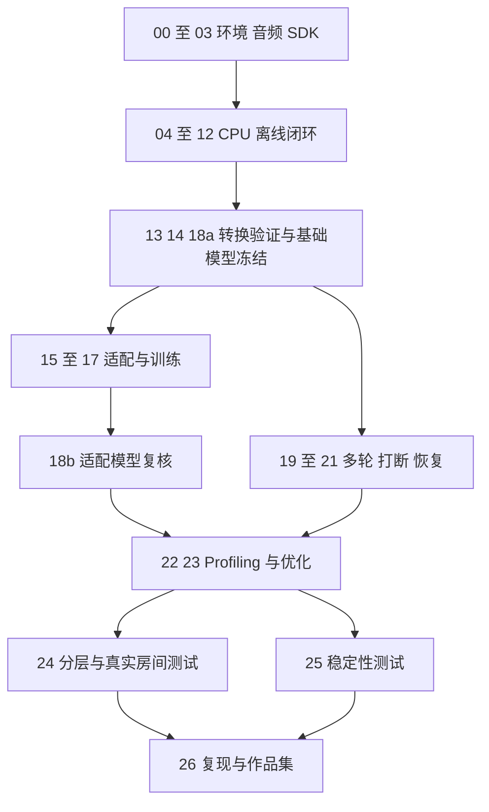

# 陪伴机器人异构端侧语音工程实施计划书

编制日期：2026 年 10 月 9 日。计划对象：基于 RK3588 与可用 RK1828 执行路径的离线语音交互工程。

当前执行范围已调整为搭建[通用工程框架](architecture.md)，语音作为可替换示例；本计划保留为候选应用方案，硬件核验、模型接入与训练排期暂不执行。后续目标明确后再修订业务阶段与预算。

项目以断网语音交互为负载，交付真实设备上的部署兼容矩阵、性能测量、至少一项有证据的优化，以及可复现的数据与适配实验。建议按单人 **320 小时**安排，先完成 CPU 参考闭环和基础模型转换验证，再投入训练和异构集成。每周有效投入 20 小时约需 16 周；每周 30 小时约需 11 周。硬件、SDK 或训练资源的等待会增加日历时间。

依据：[原始任务书](../02-companion-voice-rockchip%281%29.md)和[既有任务拆解](task-breakdown.md)。本计划补充工时、排期、阶段门槛与验收证据；原任务书决定最终范围。任务编号沿用既有清单，未列出执行证据的任务均保持待验收状态。

## 任务书分析

### 目标与交付重点

| 任务书要求 | 工程含义 | 必须保留的证据 |
| --- | --- | --- |
| 离线语音输入、对话与播报 | 音频 I/O、VAD、ASR、LLM、TTS 必须在本地形成闭环 | 断网运行命令、模型清单、完整轮次日志和实机演示 |
| CPU、NPU、协处理器对照 | 逐模型确认工具链、运行接口与精度，按测量结果分配后端 | 模型与后端矩阵、转换记录、原始 benchmark 数据 |
| 数据与训练闭环 | 使用可公开或明确授权的数据，完成可复现的轻量适配 | 数据版本、切分、训练配置、checkpoint、适配前后评测 |
| 多轮、打断和恢复 | 音频与模型任务共享轮次状态，取消后清理播放与异步结果 | 行为测试、停播时间、旧轮次丢弃记录、恢复日志 |
| 性能分析与优化 | 区分模型计算、数据传输、排队与音频等待 | 分阶段时间线、瓶颈判断、优化前后同条件对照 |
| 至少 30 分钟组合负载 | 验证持续交互、资源峰值和异常恢复 | 测试脚本、温度和资源曲线、失败及恢复统计 |

项目求职主线是异构部署和系统工程。语音质量必须足以支撑实验，但从零预训练、语音算法创新和追求最大模型规模均不在范围内。

### 需要补齐的执行条件

任务书给出了合理的总工时，但模型支持范围、训练资源、量化容差和延迟目标尚需实测确定。CPU 闭环的 20–30 小时预算仅适用于有工程经验、采用现成模型和成熟运行库、先串行运行的情形；若从零学习工具链或重写模型运行时，应重新估算。

RK1828 的实物型号与可部署模型是两件事。不能因芯片存在就预设某个模型能运行，也不能要求三种模型在三种后端上全部成功。矩阵必须覆盖候选组合，结果可以是已验证、失败、不支持或条件缺失。

现有拆解中的公开数据方案可以作为候选，但不能替代原任务书的授权核验。公开下载不等于适合音色训练、商业使用或重新分发；数据许可与模型许可分别核对。ASR 领域适配和对话轻量训练对比属于必做任务。TTS 允许按原任务书在条件不足时保留实验记录并使用公开基础模型；对话适配模型无法部署时，应保留工作站训练与对比产物。缺少训练资源不能写成训练已完成。

## 范围与资源假设

### 交付范围

| 层级 | 交付内容 | 使用方式 |
| --- | --- | --- |
| 第一里程碑 | 离线 CPU 语音闭环、阶段计时、固定输入集 | 用于验证音频和模型是否能串起来，不作为完整项目验收 |
| 主交付 | ASR 适配、对话轻量训练对比、可用后端对照、多轮与打断恢复、受限动作、性能优化、真实房间与稳定性测试 | 构成完整工程作品的核心 |
| 条件性成果 | TTS 音色适配、训练后模型的加速部署、RK1828 深度接入 | 按资源与工具链条件推进，保留成功产物或具体限制记录 |

受限动作先实现可测试的白名单接口与模拟执行器。没有实体执行器时，演示和文档只能声称完成接口验证；接入实际机器人后另做联调。打断要求用户说话后实际停播并恢复聆听，不能只用命令行取消代替验收。

### 当前输入与启动核验

本计划编制时仓库仅提供任务书和规划文档。随后已搭建通用框架与模拟示例，实际模型部署和设备交互仍待实现。既有清单记载的 2026 年 10 月 8 日环境结果是历史输入，不能作为部署验收结果。

| 资源 | 已有记录或计划假设 | 启动阶段需要确认 |
| --- | --- | --- |
| RK3588 | 历史记录为 CM3588 V2、aarch64、8 核、约 16GB 内存 | 板卡实物、CPU 拓扑、BSP、驱动、散热、电源和频率策略 |
| 音频 | 历史记录存在 ALSA 节点 | 实际麦克风与扬声器、双向录放、音量、采样率和回声 |
| 存储 | 历史记录根分区空间紧张，建议大文件放 `/userdata` | 当前剩余空间、读写权限、缓存位置和解压峰值预算 |
| RKNN 与 RK1828 | SDK、固件、通信路径和模型支持待核验 | 可运行示例、工具链平台要求、许可和接口文档 |
| 训练 | 假设可访问带 CUDA 的工作站 | GPU 型号、显存、可用时间、磁盘、数据传输及所选模型训练入口 |
| 人员 | 暂按一名实施者计算 | 每周有效工时和音频实测配合时间 |

320 小时是实施者的有效工作量，不等于 GPU 计算时长。长时间训练、归档下载和等待硬件的日历时间另记；GPU 作业运行期间可处理不依赖其结果的文档、接口或基础模型集成。

## 技术路线与阶段决策

先固定一套能在 CPU 上运行的中文 ASR、小型本地对话模型和中文 TTS，形成参考输出。第一版采用串行链路和最小后端接口，确认加载、推理、取消、错误及计时行为；完成闭环后再引入异步队列和后端切换。

端侧音频、状态机、后端封装与 benchmark 优先使用 C++/Linux；数据清洗、训练、离线评测与实验编排使用 Python。厂商示例限定语言时可以保留其运行进程，通过明确的接口接入，并在文档记录边界。

模型采用两轮筛选，避免在不可部署模型上投入训练。第一轮只选少量候选，验证公开权重、许可、CPU 推理、中文任务质量及资源占用；第二轮检查 RKNN 或厂商工具链的导出和推理路径。训练后模型重新导出、核对质量与部署能力。

| 决策点 | 进入后续阶段的条件 | 未满足时的处理 |
| --- | --- | --- |
| G0 环境可用 | 音频能录放；存储可用；CPU 运行环境明确；RK1828 状态有记录 | 修复 CPU 和音频必需条件；RK1828 不可用则记录边界，继续 RK3588 |
| G1 CPU 闭环 | 断网完成语音输入到回答播报，阶段时间可追踪 | 先分模块使用 WAV 和文本排错，不投入复杂并发 |
| G2 基础模型冻结 | 每个模型有参考输出；后端转换试验已完成；部署与训练格式明确 | 先试一个替代模型；仍失败则保留 CPU 路径和具体失败证据 |
| G3 适配结果冻结 | ASR 适配及对话轻量训练对比完成；TTS 有产物或允许的限制与实验记录 | ASR 或对话训练未完成则完整项目仍有缺项；部署按允许的边界使用基础模型 |
| G4 系统可测 | 多轮、语音打断、超时恢复和动作白名单行为通过 | 修复行为后进行正式端到端性能比较 |
| G5 优化可复现 | 有瓶颈证据，优化前后同条件对照，质量和失败率满足冻结标准 | 排除测试波动或撤回无效修改，选择其他可测瓶颈 |
| G6 最终交付 | 真房间测试、至少 30 分钟组合负载、复现命令与演示材料齐备 | 明确未达标项；存在核心缺项时只交付阶段成果 |

RKNN 与 RK1828 的初次核验共计 6 小时，RK1828 尝试不得超过该任务总预算。若无法取得可运行示例、所需 SDK 或有效通信，形成错误与缺失条件清单并结束当前阶段的尝试。后续恢复深度接入仅在条件解决且能带来可测收益时进行，计入部署或集成预算。

## 工作分解与完成条件

以下均为计划工作量，任务初始状态为待验收。负责人暂统一为实施者；实际音频测试需要现场配合，训练需要已确认的 CUDA 工作站。任务完成必须同时提交产物和证据，不能以安装工具或下载模型替代验收。

| 编号 | 任务 | 前置依赖 | 预算 | 完成条件 |
| --- | --- | --- | ---: | --- |
| 00 | 板卡与软件环境盘点 | 无 | 6h | 环境报告包含硬件、BSP、驱动、工具版本、资源与权限 |
| 01 | 存储与缓存配置 | 00 | 3h | 数据、模型、缓存与构建路径可写，下载和解压空间预算明确 |
| 02 | 实际音频录放验证 | 00 | 5h | 录音、播放与同时录放通过，设备参数及回声现象有记录 |
| 03 | RKNN 与 RK1828 示例核验 | 00、01 | 6h | 示例可运行，或提交具体错误、缺失条件与降级决定 |
| 04 | C++ 工程与配置骨架 | 00、01 | 3h | 可重复构建，模型、设备和日志路径可配置 |
| 05 | 最小后端接口 | 04 | 3h | 加载、执行、取消、错误和计时接口可供基线使用 |
| 06 | 数据登记与清洗入口 | 01 | 3h | 小型输入集可导入、校验和切分，数据与许可清单有结构 |
| 07 | 固定评测集与指标规范 | 05、06 | 2h | 时间边界、文本规范化、20 个多轮场景与版本固定 |
| 08 | VAD 与端点检测 | 02、04 | 2h | 形成语音轮次，记录误检、漏检和端点等待 |
| 09 | CPU ASR 基线 | 05、07 | 4h | 固定 WAV 识别，输出 CER、延迟和实时率 |
| 10 | CPU 对话模型基线 | 05、07 | 3h | 本地生成和上下文可用，记录首 token、速度和内存 |
| 11 | CPU TTS 基线 | 05、07 | 3h | 文本生成可播音频，记录首音频、实时率和读音问题 |
| 12 | CPU 离线闭环 | 08–11 | 2h | 实际麦克风到回答播报通过，断网运行并生成阶段日志 |
| 13 | 候选模型转换试验 | 03、09–11 | 20h | 每个模型与候选后端有转换和运行结论，失败有证据 |
| 14 | 冻结模型与部署方案 | 12、13 | 5h | 固定权重哈希、词表、前后处理、精度和训练入口 |
| 18a | 基础模型正式部署与精度核对 | 14 | 30h | 可用路径正式运行，参考输出与任务质量对照通过，基础矩阵齐备 |
| 15 | ASR 领域适配 | 06、07、14、CUDA | 30h | 数据切分、训练配置、checkpoint、CER 对照及导出可复现 |
| 16 | TTS 小规模适配 | 06、07、14、CUDA、授权 | 20h | 完成小规模实验和可懂度评测；条件不足时保留允许的限制与实验记录 |
| 17 | 对话清洗与轻量训练 | 06、07、14、CUDA、许可 | 15h | SFT 或 LoRA 产物、基线对比与模型任务完成率有记录 |
| 18b | 适配模型部署复核 | 对应 15–17、18a | 5h | 重新核对导出、Tokenizer 和精度；不可部署产物标明边界 |
| 19 | 多轮状态机与异步队列 | 12、18a | 20h | 轮次标识、队列上限、背压、超时与上下文规则实现 |
| 20 | 语音打断与回声处理 | 02、08、19 | 18h | 用户说话能实际停播并恢复收音，旧任务与缓存被取消或丢弃 |
| 21 | 异常恢复与动作接口 | 19、20 | 12h | 识别、推理和播放异常可恢复；动作白名单与参数校验通过 |
| 22 | 单模型及组合 profiling | 18a、21；适配模型另依赖 18b | 30h | 固定配置测量分阶段延迟、质量、资源与并发竞争 |
| 23 | 实施并验证一项优化 | 22 | 25h | 修改由瓶颈证据驱动，前后原始结果和复现脚本齐备 |
| 24 | 分层音频与房间测试 | 20、21、23、模型冻结 | 16h | 干净、合成噪声、真实远近场、停顿和重叠说话分别报告 |
| 25 | 稳定性与故障恢复 | 21、23 | 10h | 至少 30 分钟组合负载无无法恢复的故障，资源和恢复记录齐备 |
| 26 | 复现文档与作品集 | 18、23–25、训练或限制记录 | 12h | 构建、模型准备、运行及实验命令可复现，真实设备演示完成 |
| R | 硬件差异预留 | 出现具体问题时使用 | 7h | 用途与实际耗时进入变更记录 |
| 合计 | 27 个原任务，18 拆为两次核对 |  | **320h** | 实施工时合计，不包含被动等待 |

06 的 3 小时只交付最小数据工具入口；大规模清洗、下载排错与训练数据准备计入 15–17。18a 与 18b 合并对应原任务 18，后者为已有导出路径的复核预算；适配后需大幅重做转换时，应调整部署预算。26 的 12 小时用于汇总和复现，前面各任务需随实施保存原始记录。

03 可以用不可用证据完成可行性核验，但不能因此把部署标成成功。18a 完成后允许使用基础模型推进 19–21；训练产生新模型后通过 18b 再替换，避免基础系统等待全部训练完成。

## 依赖与排期

### 关键依赖

硬依赖主线为环境与音频 → CPU 闭环 → 基础模型部署验证 → 状态与打断恢复 → profiling → 优化 → 最终测试。训练是完整交付的另一条约束路径，ASR 适配和对话训练对比必须在最终交付前完成；它们不必阻塞基础模型的系统集成。单人工作按容量安排，不能把多条分支同时画出就当作减少了工时。

### 阶段预算

| 阶段 | 任务范围 | 原估时区间 | 本计划预算 | 累计工时 | 里程碑 |
| --- | --- | ---: | ---: | ---: | --- |
| 0 环境核验 | 00–03 | 15–25h | 20h | 20h | G0 条件与降级路径明确 |
| 1 CPU 闭环 | 04–12 | 20–30h | 25h | 45h | G1 实际离线交互通过 |
| 2 转换部署 | 13、14、18a | 40–65h | 55h | 100h | G2 基础模型与部署矩阵冻结 |
| 3 数据适配 | 15–17、18b | 55–85h | 70h | 170h | G3 训练和质量对照齐备 |
| 4 系统集成 | 19–21 | 40–60h | 50h | 220h | G4 打断恢复和动作行为通过 |
| 5 性能优化 | 22、23 | 45–70h | 55h | 275h | G5 至少一项优化有证据 |
| 6 测试交付 | 24–26 | 30–45h | 38h | 313h | G6 真实设备与复现材料齐备 |
| 预留 | R | 5–10h | 7h | **320h** | 吸收小规模硬件差异 |

原区间合计 245–380 小时，加预留为 250–390 小时。320 小时处于该区间内，前提是基础模型与工具链可用。大范围 SDK 定制、回声链路重做或缺少训练工作站均可能超出区间，不能用 7 小时预留覆盖。

### 每周 20 小时的执行示例

排期采用相对周次；启动日期和每周容量确定后再转成日历日期。

| 周次 | 20 小时内的工作安排 | 周末可审查产物 |
| --- | --- | --- |
| 第 1 周 | 环境阶段 20h | 环境、音频和 SDK 核验记录 |
| 第 2 周 | CPU 阶段 20h | WAV ASR、文本对话与 TTS 基线 |
| 第 3 周 | CPU 收尾 5h，转换阶段 15h | 实际 CPU 闭环，第一批转换结论 |
| 第 4 周 | 转换阶段 20h | 各后端转换与初步质量对照 |
| 第 5 周 | 转换阶段 20h | 基础模型冻结和正式部署矩阵 |
| 第 6 周 | 数据适配阶段 20h | 许可、切分和 ASR 训练入口 |
| 第 7 周 | 数据适配阶段 20h | ASR 训练产物与固定集对照 |
| 第 8 周 | 数据适配阶段 20h | TTS 和对话实验记录 |
| 第 9 周 | 适配收尾 10h，集成阶段 10h | 适配部署复核与状态机初版 |
| 第 10 周 | 集成阶段 20h | 异步队列、取消与打断验证 |
| 第 11 周 | 集成阶段 20h | 多轮、恢复和受限动作验收 |
| 第 12 周 | 性能阶段 20h | 单模型和组合负载原始测量 |
| 第 13 周 | 性能阶段 20h | 瓶颈结论与优化实现 |
| 第 14 周 | 性能收尾 15h，测试阶段 5h | 优化前后对照，分层测试启动 |
| 第 15 周 | 测试阶段 20h | 真实房间与组合负载稳定性结果 |
| 第 16 周 | 测试收尾 13h，预留 7h | 可复现文档与真实设备演示 |

每周 30 小时按 320 ÷ 30 向上取整为 11 周，必须按任务依赖重新分配，不能缩短必需的稳定性测试。若只能每周投入 10 小时，按相同工作量约需 32 周。每周记录实际耗时与剩余任务，完成 G0、G1、G2 后分别重估一次。

## 数据与模型实验计划

公开数据沿用既有方案作为候选：ASR 使用 AISHELL-1 候选子集，TTS 使用 AISHELL-3 候选说话人，噪声增强使用 MUSAN 候选子集；对话数据先核对数据卡和额外限制，再决定是否使用 BELLE 候选或其他可用数据。此处不把候选许可视为已完成核验。数据包版本、模型版本和授权适用范围在实际下载与训练前登记。

第一轮控制规模：ASR 适配候选为 10–20 小时训练语音，TTS 为 1 名许可适用且录音足够的说话人，对话为约 1000–5000 个清洗后的完整会话。先完成小样本训练、导出和评测，再在预算内扩大。ASR 领域适配样本需包含可授权的交互表达或产品词；如果公开数据缺少目标领域，只能先声称普通话适配实验，不能推断真实机器人领域收益。

训练集合与最终测试集合按原始录音、说话人、场次和环境隔离；ASR 优先采用官方切分，增强只作用于训练集合，同源衍生样本留在同一集合。TTS 已知说话人音色适配按场次和文本隔离；未见说话人评测另设实验。对话按完整会话和重复内容分组切分。保留基础模型预训练数据说明，项目切分隔离不等于证明基础模型从未见过测试语料。

每个训练实验至少输出数据清单、随机种子、训练配置、基础模型哈希、checkpoint、导出产物，以及固定集上的适配前后质量和资源比较。训练失败也要保留日志与错误归因；失败记录不能替代原任务书要求的 ASR 适配成果。

模型包需包含权重、Tokenizer 或词表、前后处理配置、精度与转换命令。LoRA 若需要合并后导出，应验证合并后的输出；只评测工作站上的 adapter 不足以证明端侧部署效果。

## 验收与指标冻结

### 行为与质量验收

| 项目 | 验收方法 | 判断依据 |
| --- | --- | --- |
| 离线闭环 | 断网运行真实收音、识别、对话和播报 | 无远程模型调用，端到端轮次日志完整 |
| 多轮与动作 | 至少 20 个独立固定场景，覆盖记忆、澄清、取消和非法动作 | 正常场景按固定规则评分；未知动作、非法参数和取消轮次不得执行 |
| 语音打断 | 播报期间用户说话，记录实际停播和恢复收音 | 旧轮次的音频、token 和动作结果均不进入新轮次 |
| 异常恢复 | 注入识别失败、推理超时和播放错误，再发起正常轮次 | 可恢复收音与交互；报告恢复时间和次数 |
| ASR | 固定文本规范化计算 CER，必要时按固定分词报告 WER | 基线与适配使用同一测试集，噪声与距离分层报告 |
| TTS | 固定文本覆盖数字、产品词和中英混读，人工核查可懂度 | 人工结果与自动转写代理结果分开报告 |
| 对话模型 | 固定多轮任务和动作场景，对比基线与适配 | 报告任务完成率、首 token 延迟、生成速度和拦截结果 |
| 组合稳定性 | 连续至少 30 分钟，ASR、LLM、TTS 进程驻留且有实际计算重叠 | 无无法恢复的故障，记录延迟抖动、峰值、温度和恢复 |

仅让三个空闲进程驻留 30 分钟不算组合负载。稳定性脚本需包含连续轮次、播报时收音和打断，形成可观测的阶段重叠；串行闭环与并发压力测试分别报告。

### 时间边界与采样规则

统一使用单调时钟记录轮次事件。端到端首音响应定义为用户实际说话结束至扬声器输出第一段有效回答语音，包含端点检测、推理、排队和播放等待。自动化 WAV 测试的结束点由输入标注确定；真实房间通过录音回放标注用户结束点，扬声器出声通过声学回录或可验证的硬件时间戳确定。仅记录写入播放缓冲区时，必须标为播放提交时间，不能写成实际可听时间。

ASR 和 TTS 实时率分别为处理时间除以输入语音或输出音频时长；同时记录冷启动、流式首结果和完成时间，不能只报一个吞吐数。LLM 首 token 延迟从请求提交起算，同时保留排队与模型执行拆分；记录上下文长度、输入输出 token 数和解码参数。

单模型建议预热后至少 100 次测量，完整交互建议至少 100 轮，覆盖正常、打断和恢复场景。公布样本数、原始记录、P50/P95 和失败率；延迟分位数可以在成功样本上统计，但失败与超时必须另列，禁止静默删除。冷启动与预热测量分开。

跨后端比较固定模型和输入，记录各路径的实际精度、线程、频率、温度、SDK 与运行库；能够固定的条件保持一致，无法一致的条件显式列出。同模型的转换差异和不同模型的系统选型分别比较。

### 质量容差与性能目标

原任务书没有规定端到端毫秒门槛。以下数值是用于 G1 后讨论并冻结的计划目标，不代表已有实测能力，也不自动成为原任务书的硬指标。

| 指标 | 初始计划目标 | 冻结方式 |
| --- | --- | --- |
| ASR 与 TTS 实时率 | 各自 RTF < 1 | G1 记录基线；若不满足，列入优化与最终未达标项 |
| 后端转换 ASR 质量 | CER 增加不超过 1 个绝对百分点 | G1 后按固定集与样本量调整，G2 正式比较前冻结 |
| 对话任务完成率 | 20 个固定场景至少通过 18 个 | 固定评分规则；动作越权场景必须全部拦截 |
| 打断停播延迟 | P95 ≤ 300ms | 包含语音检测至实际停播，G1 后按音频缓冲能力评估并冻结 |
| 端到端首音延迟 | G1 后设绝对目标，优化优先降低 P95 | 固定回答长度、输入分层、上下文和解码配置后设定 |
| 优化收益 | 优先争取主要瓶颈或端到端 P95 改善 ≥ 10% | 原任务书必需条件为有效优化；同条件重复测量判断收益是否超出波动 |
| TTS 与对话转换质量 | G1 后按人工可懂度、任务评分和参考输出制定容差 | 不以不同后端文本完全相同作为唯一正确性条件 |

冻结结果写入实验配置并在 benchmark 前保存版本，不能测完后调整容差来宣称通过。优化可能改善内存或资源占用而非延迟，应明确改善指标、质量约束与失败率，不强行包装为延迟收益。

CPU、NPU、RK1828 占用及功耗只报告实际可测范围。没有硬件计数器或功耗仪时标记未测量；线程时间、厂商峰值或板卡标称功耗不能替代对应实测。

## 风险与调整规则

| 风险 | 触发信号 | 处理与范围影响 |
| --- | --- | --- |
| RK1828 SDK 不可用 | 6h 初核内无法完成示例或通信 | 保存边界记录，采用 RK3588 CPU/RKNN 主线 |
| RKNN 模型不兼容 | 导出失败、算子不支持或精度超限 | 在 13 的预算内试一个替代模型或支持的精度；仍失败保留 CPU 对照 |
| CUDA 资源缺失 | G0 无法确认工作站，或训练入口不可用 | 继续基础系统；ASR 适配与对话训练保持缺项，训练恢复后再完成最终交付 |
| 模型内存或吞吐不足 | 单模型可运行，组合出现 OOM、排队或 RTF 超标 | 缩小模型与上下文，减少复制，实施背压；作为新的实验版本复测 |
| 播报回声导致误打断 | 播放自己的声音触发 VAD/ASR | 保留全双工录音排查，验证播放参考与回声消除；按键打断仅作诊断手段 |
| 数据许可或领域不匹配 | 附加条款不适用、缺少交互领域内容 | 换用许可适用来源，缩小结论范围；必要时另筹授权数据 |
| 存储不足 | 归档和解压峰值超出可用空间 | 分批处理与清理，增强在线生成，缓存和大文件放仓库外 |
| 温度和测量波动 | 重复实验差异明显、降频或后台竞争 | 固定散热和频率条件，保留温度曲线后重新测量 |

每周记录已耗工时、剩余估时、阻塞条件与交付状态。单任务耗时超过预算约 25%，或阶段门槛未满足时，先停止新增范围，定位原因并重新排期。模型更换、数据集更换和精度调整均建立新实验版本，保留旧基线。

优先减少候选模型数量、RK1828 深度定制和训练规模，保留 CPU 闭环、ASR 适配、对话训练对比、兼容性证据、打断恢复、有效优化及 30 分钟稳定性测试。若资源不足以保留这些核心项，应交付明确的阶段成果和剩余清单，不能宣布完整任务完成。

## 交付目录与可追溯记录

以下是后续产物位置建议，除本计划外不代表文件已经存在。

| 路径 | 主要内容 |
| --- | --- |
| `docs/environment.md` | 环境、音频、SDK、存储与复现构建条件 |
| `docs/model-selection.md` | 候选筛选、冻结模型、许可与适配入口 |
| `docs/deployment-matrix.md` | CPU、RKNN、RK1828 各组合的状态与证据 |
| `docs/evaluation.md` | 测试切分、指标规则、质量容差与结果 |
| `docs/optimization-report.md` | 瓶颈、修改和前后对照 |
| `docs/stability-report.md` | 真实房间、组合负载与恢复结果 |
| `configs/` | 设备、模型、数据与实验配置 |
| `src/audio/`、`src/runtime/`、`src/pipeline/` | 音频、后端和状态机实现 |
| `tools/data/`、`tools/train/`、`tools/eval/` | 数据、适配与评测入口 |
| `benchmarks/`、`tests/` | 性能采集及取消、恢复、动作行为测试 |
| `/userdata/robot-voice-stack/` | 仓库外的 datasets、models、cache、build 和 runs |

每次实验保存代码版本、配置版本、模型哈希、数据清单、运行命令、设备条件、原始日志与汇总表。模型与后端矩阵至少包含模型版本、输入规格、精度、工具链、转换状态、运行状态、质量变化、P50/P95、内存、证据路径与失败原因；未测量字段留空并写明原因。

最终作品集必须能回答：哪些模型在哪个后端上真正运行，失败原因是什么，哪个阶段形成瓶颈，优化带来了什么收益，质量有何变化，以及别人如何复现。模型训练成果与部署成果分别表述，不使用厂商宣传指标代替个人测量。

## 首批执行安排

第一周预算 20 小时，目标为 G0。前 6 小时保存板卡、系统和工具链报告；随后 3 小时配置大文件及缓存路径；5 小时完成实际录放和双向音频检查；最后 6 小时核验厂商示例并形成后端可行性记录。同时确认 CUDA 工作站和数据许可核验入口，未解决的条件列入后续阻塞清单。

若后续恢复本方案，第一周结束至少形成四类记录：环境报告、存储配置、录放样本与参数、SDK 示例结果或失败证据。第二周进入 CPU 模型基线，先打通 WAV 输入到回答音频，再完成真实麦克风闭环。当前优先搭建通用框架，模型下载、环境安装、训练和硬件测试暂不执行。
